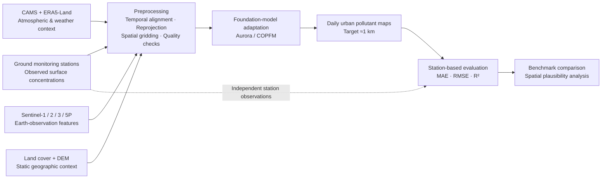

# 🌍 Foundation Models for High-Resolution Air Quality Maps

### From sparse ground observations to neighborhood-scale pollution intelligence

**Applied Data Science Project · Politecnico di Torino**  
**Study areas:** Turin & Milan, Italy · **Target resolution:** ~1 km · **Temporal resolution:** Daily

> **Project status — First checkpoint / proposal.** This README describes the scientific objectives, intended methodology, and planned deliverables. Model training, benchmarking results, and reproducible execution instructions will be documented as implementation progresses.

## Overview

Air pollution varies sharply across cities, but regulatory monitoring stations measure pollutant concentrations only at a limited number of fixed locations. As a result, station observations alone cannot fully describe neighborhood-level exposure, traffic-related hotspots, or urban–rural gradients.

This project investigates whether **pretrained environmental and Earth-observation foundation models** can combine **satellite imagery, meteorology, atmospheric composition, topography, and ground measurements** to produce **daily, high-resolution maps of surface air pollutant concentrations** over **Turin and/or Milan**.

The central research question is:

> Can foundation-model-based approaches generate spatially detailed, physically plausible urban air-quality maps while matching or improving the predictive accuracy of coarse-resolution baselines at independent monitoring stations?

## Research objectives

| Dimension | Target |
| --- | --- |
| **Primary task** | Regression of near-surface pollutant concentrations on an urban grid |
| **Pollutants** | Nitrogen dioxide (NO₂), sulfur dioxide (SO₂), ozone (O₃), PM₁₀, and PM₂.₅ |
| **Study area** | Turin and/or Milan, Italy |
| **Spatial resolution** | Approximately **1 km**; **500 m** may be explored |
| **Temporal resolution** | Daily |
| **Nowcasting** | Estimate concentrations for the day of the input observations |
| **Forecasting (exploratory)** | Predict concentrations one day ahead; longer horizons are out of scope |
| **Candidate models** | **Aurora** and **Copernicus Foundation Model (COPFM)** |
| **Evaluation** | MAE, RMSE, R², comparison with coarse baselines and spatial plausibility checks |

The first checkpoint emphasizes **same-day nowcasting**. The original project brief also identifies **one-day forecasting** as a second experimental setting, subject to available inputs and implementation progress.

## Why this matters

The motivating study material identifies **65 air-quality monitoring stations in Milan** and **15 in Turin** within the illustrated coverage areas. Such stations provide important reference measurements, but they leave spatial gaps between their locations.

Daily gridded predictions could help stakeholders:

- **Identify pollution hotspots** and urban–rural concentration gradients.
- **Inform urban and mobility decisions**, including assessments of traffic and low-emission measures.
- **Support monitoring-network design** by highlighting poorly observed areas.
- **Provide spatial context for exposure assessments** and environmental research.

These are **potential applications**, not claims that the proposed maps have been operationally validated or deployed for public-health decision-making.

## Proposed methodology

### 1. Data preparation

Potential preprocessing operations include coordinate-reference-system alignment, resampling to a common grid, unit harmonization, temporal matching, masking invalid pixels, and handling missing observations. Particular care is needed to prevent spatial or temporal information leakage between model development and evaluation.

### 2. Foundation-model adaptation

Two research candidates are proposed:

- **Aurora:** a foundation model designed for atmospheric prediction tasks.
- **COPFM (Copernicus Foundation Model):** a candidate foundation-model approach for Earth-observation data, including relevant Copernicus imagery.

The project will investigate how these pretrained representations can be adapted to **urban-scale surface concentration regression**. The exact adaptation strategy and architecture are to be determined experimentally; neither candidate is presented here as already trained for this use case.

### 3. Map generation

The intended output is a **georeferenced daily concentration raster** for each target pollutant, with values on an approximately **1 km grid** over the selected study area. The specific output format and visualization interface will be defined during implementation.

## Data sources

| Source | Information | Intended role |
| --- | --- | --- |
| **Ground monitoring stations** | In-situ surface pollutant measurements | Reference observations and validation targets |
| **Sentinel-1** | Radar / SAR backscatter | Surface and built-environment context |
| **Sentinel-2** | Multispectral optical imagery | Land-surface and urban-context features |
| **Sentinel-3** | Land Surface Temperature (LST) | Thermal surface context |
| **Sentinel-5P** | Atmospheric trace-gas column observations | Atmospheric composition features |
| **CAMS** | Modeled atmospheric pollutant concentrations | Coarse surface baseline and potential pseudo-labels |
| **ERA5-Land** | Meteorological reanalysis | Temperature, wind and related weather predictors |
| **Digital Elevation Model (DEM)** | Elevation and terrain | Geographic / topographic context |
| **Land-cover data** | Surface classes | Additional fine-scale spatial context |

**Important scientific distinction:** Sentinel-5P column products describe atmospheric-column quantities (often in **mol/m²**) and **must not be treated as direct ground-level measurements**. CAMS modeled surface concentration fields may use units such as **µg/m³**, corresponding more directly to in-situ station targets. Appropriate variable-specific conversions and matching will be required.

The source documents describe **available or candidate data products**; this README does not imply that all datasets have already been downloaded, cleaned, or licensed for redistribution.

## Evaluation strategy

Numerical performance will be assessed **at monitoring-station locations** using observations that are independent of the corresponding model training data.

| Metric | Interpretation | Desired direction |
| --- | --- | --- |
| **MAE** — Mean Absolute Error | Average magnitude of prediction errors | ↓ Lower |
| **RMSE** — Root Mean Squared Error | Gives greater weight to large errors | ↓ Lower |
| **R²** — Coefficient of Determination | Agreement with observed variability relative to a mean baseline | ↑ Higher |

The planned validation protocol includes:

1. **Hold-out evaluation:** test on unseen time periods and, where feasible, held-out monitoring stations.
2. **Baseline comparison:** compare predictions against appropriately matched coarse-resolution atmospheric estimates at station coordinates.
3. **Spatial plausibility checks:** inspect urban–rural gradients, road-related patterns, and industrial hotspots, rather than rewarding visually smooth upsampling alone.
4. **Pollutant-wise reporting:** report metrics separately for each available target pollutant and study area.

**Success criterion:** The adapted approach should **match or outperform the coarse baseline** on independent observations while producing spatial patterns consistent with the available environmental context. This is a *target*, not a reported result.

## Expected deliverables

- [ ] **Reproducible benchmark:** compare Aurora and COPFM with suitable coarse-resolution and/or simpler regression baselines.
- [ ] **High-resolution pollutant maps:** produce daily concentration estimates at approximately 1 km over Turin and/or Milan.
- [ ] **Evaluation artifacts:** pollutant-specific error metrics, visual comparisons, and spatial plausibility analysis.
- [ ] **Open research repository:** publish implementation code, reproducibility documentation, and a concise technical report; release model weights only where permissions and hosting constraints allow.

### Current development stage

| Work package | Lead | Planned period |
| --- | --- | --- |
| Project management | Cristian Sician | November |
| Research and familiarization | Seyedmostafa Seyedi | November |
| Data exploration and visualization | Cristian Sician | November |
| Model implementation and training | Seyedmostafa Seyedi | December |
| Evaluation and testing | Cristian Sician | December–January |
| Report and documentation | Seyedmostafa Seyedi | January |

*Timeline reflects the first-checkpoint proposal (November–January), not verified completion dates.*

## Reproducibility and repository setup

This repository is currently described at the **project-proposal stage**. A verified dependency file, directory structure, runnable training commands, and pretrained-weight instructions have **not yet been established** in the supplied materials. Those instructions will be added when implementation files become available.

Planned documentation will cover data provenance and access, preprocessing configuration, train/validation/test splits, model checkpoints, inference, metric reproduction, software dependencies, and random seeds.

## Stakeholders and use cases

| Stakeholder | Potential application |
| --- | --- |
| **Environmental agencies** (e.g., regional ARPA bodies) | Detect hotspots, assess monitoring gaps, guide station placement |
| **Municipalities / urban planners** | Compare spatial patterns relevant to mobility and emissions policies |
| **Public-health authorities** | Add spatial context to exposure studies and risk communication |
| **Academic researchers** | Benchmark methods and investigate urban environmental modeling |
| **Earth-observation and research partners** | Explore integration of multi-source Copernicus products and foundation models |

## Sustainability alignment

This work is aligned with three **UN Sustainable Development Goals (SDGs)**:

- **SDG 9 — Industry, Innovation and Infrastructure:** explore scalable, foundation-model-based environmental mapping methods.
- **SDG 11 — Sustainable Cities and Communities:** provide neighborhood-level spatial evidence relevant to urban planning and monitoring.
- **SDG 13 — Climate Action:** strengthen environmental observation and evidence-based analysis of urban pollution challenges.

Air-quality improvement and climate mitigation are related but distinct outcomes; this project focuses on **pollutant concentration mapping**, not direct measurement of greenhouse-gas emissions reductions.

## Research background

The following papers are identified in the initial project brief:

1. **Aurora: A Foundation Model of the Atmosphere** — [arXiv:2405.13063](https://arxiv.org/abs/2405.13063)
2. **Towards a Unified Copernicus Foundation Model for Earth Vision** — [arXiv:2503.11849](https://arxiv.org/abs/2503.11849)
3. **Urban Air Pollution Forecasting: a Machine Learning Approach leveraging Satellite Observations and Meteorological Forecasts** — [arXiv:2405.19901](https://arxiv.org/abs/2405.19901)

Useful data and geospatial resources include [Copernicus Data Space](https://dataspace.copernicus.eu/), [Copernicus Atmosphere Monitoring Service (CAMS)](https://atmosphere.copernicus.eu/), [Copernicus Climate Data Store](https://cds.climate.copernicus.eu/), and [Rasterio documentation](https://rasterio.readthedocs.io/).

## Project team

**Applied Data Science Project — Politecnico di Torino**

- **Seyedmostafa Seyedi** — Research and familiarization; model implementation and training; report and documentation.
- **Cristian Sician** — Project management; data exploration and visualization; evaluation and testing.

Work-package assignments reflect the planning presentation and do not exclude shared contributions.

## Acknowledgments

This project is developed in an academic context with research guidance connected to **LINKS Foundation** and makes reference to the European **Copernicus** and **ESA** Earth-observation ecosystems. Mention of these institutions and platforms does not imply formal endorsement or sponsorship.

## License and data usage

**License not yet specified.** Before reusing code, model weights, figures, or datasets, review the eventual repository license and the terms of the relevant upstream providers. Third-party Earth-observation products and pretrained checkpoints may carry separate terms and attribution requirements.

---

**Better spatial evidence for healthier, more informed cities.**

*Research proposal · Results and runnable code will be added as they become available.*

